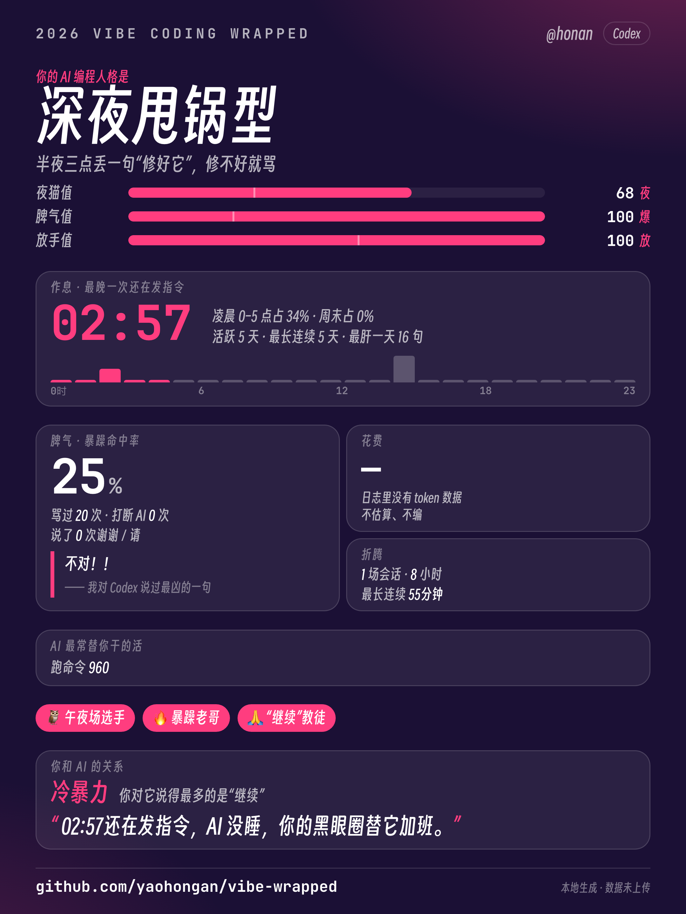

# vibe-wrapped · Vibe Check：你和 AI 写代码的人格报告

> 程序员版 Spotify Wrapped。读你本机的 **Claude Code** 和 **Codex** 会话日志，算出你这一年怎么跟 AI 写代码，给你一个人格类型和一张能直接发的海报。
> Local-only Spotify-Wrapped for vibe coders. Reads your Claude Code + Codex logs, gives you a persona and a shareable poster. Nothing leaves your machine.

<p align="center"></p>

## 安装（30 秒）

**把下面这句话原样发给 Claude Code 或 Codex，它会自己装好：**

```
帮我安装这个 skill：https://github.com/yaohongan/vibe-wrapped
```

装完**重启**，然后：

| 平台 | 怎么触发 |
|---|---|
| Claude Code | 直接说 **“生成我的 vibe 本周报告”**（或 `/vibe-wrapped`） |
| Codex | 输入 **`$vibe-wrapped`**，或说“生成我的 vibe 本周报告” |

**一句话指定时间维度**，想看哪段就说哪段：

| 你说 | 范围 |
|---|---|
| 生成我的 vibe **本周**报告 | 近 7 天 |
| 生成我的 vibe **本月**报告 | 近 30 天（不说时间默认就是它，日志不足 30 天则取全部） |
| 生成我的 vibe **近三个月**报告 | 近 90 天 |
| 生成我的 vibe **近半年**报告 | 近 180 天 |
| 生成我的 vibe **今年**报告 | 今年 1/1 至今 |
| 生成我的 vibe **全部**报告 | 有日志以来 |
| …**从 3 月 1 日到 3 月 31 日** | 自定义日期 |

3 分钟内得到海报 PNG（**直接显示在对话里**）+ 可复制的小红书 / X 文案。全程本地，不联网，不上传。第一次出图后 Agent 会问你一次**昵称**（不要也行），之后自动出现在海报左上角。

<details>
<summary>给 Agent 的安装指引（人类可跳过）</summary>

1. 克隆并运行安装脚本（脚本用**复制**，Codex 会跳过软链）：

   ```bash
   git clone --depth 1 https://github.com/yaohongan/vibe-wrapped /tmp/vibe-wrapped && bash /tmp/vibe-wrapped/install.sh
   ```

   它会复制到 `~/.claude/skills/vibe-wrapped`、`~/.agents/skills/vibe-wrapped`、`~/.codex/skills/vibe-wrapped`。只装一个平台用 `bash install.sh --claude` 或 `--codex`。
2. 没有 bash / Windows：把仓库里的 `SKILL.md`、`scripts/`、`templates/`、`data/` 复制到上述任一目录下的 `vibe-wrapped/` 即可。
3. 验证：`python3 ~/.claude/skills/vibe-wrapped/scripts/wrapped.py doctor`（需要 Python ≥3.9，只用标准库；渲染用本机 Chrome/Edge）。
4. 告诉用户**重启** Claude Code / Codex，并说出上面的触发方式。
5. 旧版 Codex 看不到 skill 时，在 `~/.codex/config.toml` 加 `[features] skills = true`。

</details>

不装 Skill 也能直接跑：`python3 scripts/wrapped.py all`（使用预设短评）。

## 你会得到什么

<p align="center"></p>

| 文件 | 用途 |
|---|---|
| `poster-3x4.png` | 1080×1440（2× 清晰度），小红书 / 朋友圈 / X |
| `poster-9x16.png` | 1080×1920，故事 / 全屏 |
| `poster-*.html` | 同内容的网页版，可直接在浏览器打开 |
| `share.txt` | 可复制的小红书文案、X 文案、**让你的 AI 当面吐槽你的提示词** |
| `metrics.json` / `persona.json` | 全部数字与来源，海报上每个数字都能在这里查到 |

**海报里有什么**：三字人格代号（夜/昼 · 爆/温 · 放/控，像 MBTI 一样好交代）、“已打卡 N 天”印章、全年打卡热力图、最晚一次还在发指令的时间、暴躁命中率与最凶的一句（已脱敏）、折合多少杯奶茶、成就徽章、和 AI 的“关系诊断”，以及一句毒舌短评。8 种人格各有自己的主题色和角标。

8 种人格：深夜甩锅型、熬夜暴躁监工、午夜甩手掌柜、深夜温柔调教型、白天甩锅型、暴躁监工型、甩手掌柜型、温柔调教型。

## 常用参数

```
--range week|month|quarter|halfyear|year|all   （默认 auto：近 30 天，不足则全部；也认 本周/本月/半年/今年/全部）
--since 2026-03-01 --until 2026-03-31 | --year 2025
--tz Asia/Shanghai          时区（默认系统时区）
--platform claude_code|codex
--show-projects             显示真实项目名/文件名（默认匿名：项目 A/B/C，*.tsx）
--no-quotes | --show-quotes 原话：不显示 / 关闭脱敏（默认脱敏）
--nickname NAME             海报左上角昵称（或先 `wrapped.py profile --nickname NAME` 保存，之后自动使用）
--size 1080x1440|1080x1920
--html-only                 只输出 HTML
```

## 设计原则

1. **确定性**：所有数字和人格由 Python 脚本算，同样的输入同样的输出；AI 只写最后一句 ≤40 字的毒舌短评。
2. **全本地**：无任何网络请求（有测试覆盖）；只读会话目录，不读 `auth.json` 等认证文件。
3. **隐私默认保守**：项目名/文件名默认匿名；原话默认脱敏（邮箱/URL/路径/密钥/长数字）；给 AI 看的 `persona.json` 只含聚合数字。
4. **只依赖标准库**：Python ≥3.9。渲染用本机 Chrome/Edge/Chromium headless，其次 Playwright，最后只输出 HTML。

## 口径说明

- 窗口默认今年 1 月 1 日至今；子代理（subagent）消息不计入你的行为指标，但计入花费。
- 花费按 `data/pricing.json` 的 **API 标准价**估算，订阅用户实际支出不同；价格表更新日期见文件头。
- Codex 日志有多代格式并存，适配器自动兼容；老版本没有 token 数据的会话不估算成本。
- 单条用户消息按 500 字封顶计入平均字数，避免粘贴整篇文档把均值拉歪。
- 日志是各 CLI 的内部格式，随版本会变；坏行占比 >5% 时会提示“日志格式可能更新了”。

## 开发

```bash
python3 -m unittest discover -s tests
```

MIT License
